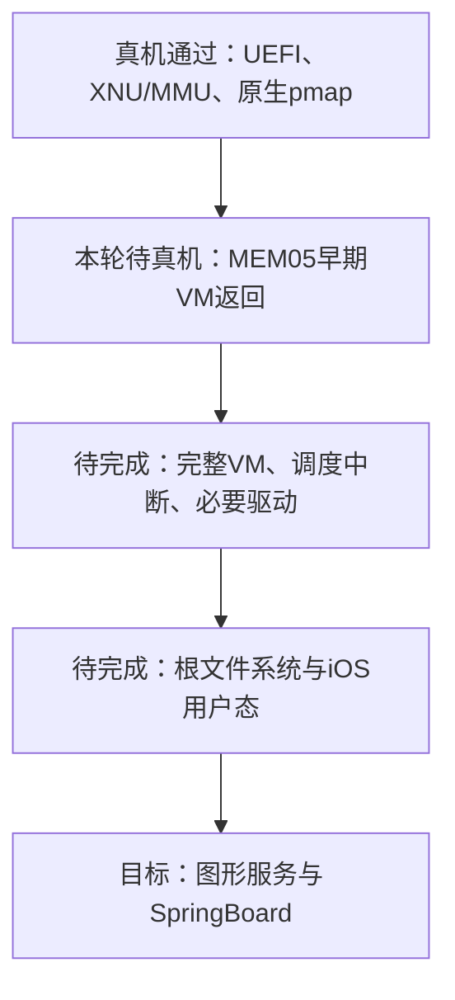

# MEM05 新镜像已就绪，交用户录像后手动执行

状态：PASS_L2_328_READY_FOR_USER_MANUAL_RECORDED_BOOT。助手未运行 execute、adb reboot 或 fastboot；L3 不存在，镜像未消费。MEM01/MEM02/MEM03/MEM04 已消费镜像继续禁止启动。

- Run：thor-20261026-vm-mem05；Mac 根 /Users/<user>/projects/thor-unixnu。
- 新 Boot v4：runs/thor-20261026-vm-mem05/l2/package/thor-boot.img，25,894,912B；SHA256 cebebd3f292d2fcee7c7b3d3511f704055543c860c93c2abde2f652069b8caa5。新随机种子只在 Mac 生成保留，不再重新打包。
- 正式 L2 328/328 PASS：l2/package/independent-offline.json；SHA1994209fe93b62d9b124f5dc6f3109930d0730d889ed3134c5803a68e13cd9ae。
- Controller READY_NOT_EXECUTED：l2/controller/controller-preflight.json；SHA71dc83e87a5a4cc07b1179d9e8bd3fc6d0d16d619f311b14077bc4cd22abb91c。源码、工具、输入及未消费状态均重核；设备只读7/7通过。
- XNU source16194ea46fcd34b922c9cbe929ea78a76cdf6314；kernel765bcb34234def5ba344a593e9ef76176d44d0fdd1576dabef0eae043d1c9c89；candidate014的七文件保持冻结。两次真实内核link一致，20项生产C/PTD/CFG已通过，按源码/log SHA复用，不重复执行。
- UEFI ff97917af663010173cd6077b6cad4904e76c901；FDd955d097f79b36439d0b4a2ac24ddb7dd87aeebc1b958f58a6c0b2fdc9863dc6；正式证据runs/thor-20261026-vm-mem05-host-05/l2。03/04两次真实强制link一致；最后两文件测试名称更新不改变FD/PE，05构建也字节一致。
- 45项UEFI测试、19帧真实C渲染、379输入逐hash及Mac完整FV/FFS/LZMA/20PE/96lib重放通过。打包回归79/79、新gate63/63通过。独立XNU预检103条件PASS，正式L2引用02精确SHA并重核全部冻结输入。
- 500B transition不是旧8ce：新7acb7a64ca5de2090534707cef6941f5492837c8fc4b87212cc8e4306ea789c2。加载跨度+0x4000，四word[76,96,100,156]仅MOVZ/MOVK立即数改变，484B相同；transition/args/entry/vector/stack-top五对独立解码，无重定位。
- 原生L3两循环最多20页，初始102 PTD至少剩82；保留原43页pmap预算与全部前后守卫。新增0E L3 CALL、0F VM RETURN，返回后核对根/PTE/335FB/PTD/LowGlo并12秒有界复位。尚无MEM05真机成功证据，未放行pmap_map_globals或后续完整平台初始化。
- 五FDT窗口仍只读；未知trust_ui/ramoops大小仍阻塞RAM所有权，不开放新256MiB。UI保留阶段独占布局、00–0F编号与独特配色。
- 曾被连接器拒绝的额外五项CLI注入未执行、不计PASS、不变形重试。见本run l2/validation-scope.json。

用户先开始连续录像，再在Mac终端仅执行一次：

```bash
cd /Users/<user>/projects/thor-unixnu && \
./toolchains/python313/bin/python3 -B \
  runs/thor-20261026-vm-mem05/l2/controller/controller.py execute \
  --preflight runs/thor-20261026-vm-mem05/l2/controller/controller-preflight.json \
  --recording-confirmed \
  --confirm-run-id thor-20261026-vm-mem05 \
  --confirm-image-sha256 cebebd3f292d2fcee7c7b3d3511f704055543c860c93c2abde2f652069b8caa5
```

手机返回Android以后单独执行：

```bash
cd /Users/<user>/projects/thor-unixnu && \
./toolchains/python313/bin/python3 -B \
  runs/thor-20261026-vm-mem05/l2/controller/controller.py monitor \
  --preflight runs/thor-20261026-vm-mem05/l2/controller/controller-preflight.json
```

保留完整录像至回Android，拍清00–0F、特别0E/0F和五FDT窗口；如出现故障，拍清S/P/A/R。任意失败或中断后不要重跑execute。将终端结果与录像交回再判断实测前沿。



当前真机前沿仍是MEM04的00–0D与原生pmap返回后守卫；整体进度不提供无依据百分比/日期。每轮继续给整体流程图。
