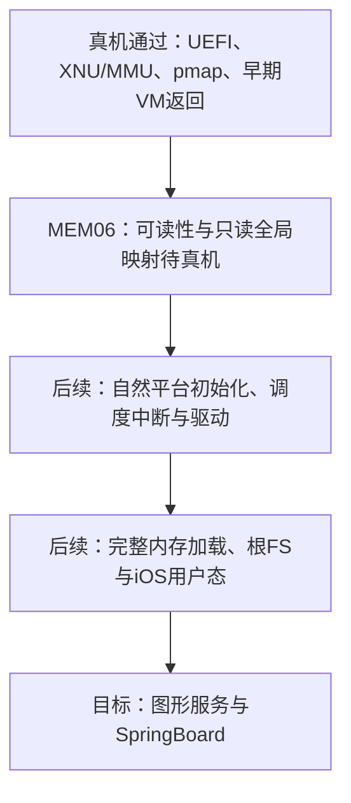

# MEM05 真机结果与 MEM06 手动验证交接

MEM05 已消费，禁止再次启动。用户2026-10-26 18:55 CST唯一临时boot，18:56独立monitor 7/7正常。四张原图的字节数、SHA256和Library ID保存在evidence/hardware-tests/thor-20261026-vm-mem05/visual-review.json；原图不写Git。

三张图显示00–0F完整，0E L3 CALL/CALL、0F VM RETURN/PASS。按冻结原生顺序门禁，证明两组原生L3循环、实际早期arm_vm_init返回及返回后根/别名/PTD/LowGlo守卫通过。另图是网格出现前UEFI画面；UEFI 3 BEFORE EBS是冻结背景，不是此后的XNU PC。静态照片不证明精确时序或复位原因；未到完整VM、平台初始化或iOS用户态。

五窗口L0/L1/H0/H1/H2均S22 IN1 DY15 UN2 CF0；DYW低12/高4。trust_ui_vm_region@e0b00000(phB8、offset1488、no-map1)和ramoops_region(ph263、offset1EA4、no-map0)仍status ABSENT、reg/size缺失；ramoops仅有alloc-ranges 0+FFFFFFFFFFFFFFFF。仍不授权256MiB；PAD1 OFFSET2698仍须保留诊断。

顶部原方案为浅色大背景配深灰字，实拍对比度不足。MEM06改为固定080C12深底、FFFFFF白字、各格原有独特颜色仅作左/下边条，保留4×4、328×42、y64..287。生产C实跑11项、7项PTE策略测试PASS；20处真实A64 STRW字形写入独立解码为白色，文字对比度19.596:1。既有20项C/PTD/CFG按不变源码/log hash明确复用，没有重复执行。

MEM06也将315页网格别名从L3 slots0..314移到16..330，保留原20页slots480..499，给原生LOWGLOBAL_ALIAS的slot2留空；335页物理地址/属性及全部其余零PTE已解释实际机器码逐项确认，无新页表分配、无RAM扩容。新增原生pmap_map_globals调用和写前/返回后检查。

原生全局映射另发现实际权限缺陷：AP_RONA=2，直接OR只影响PTE低类型位；MEM06修为ARM_PTE_AP(AP_RONA)，实际leaf flags0060000000000683。独立raw A64解码、guard支配单次PTE写、删除只读bit/前置/原生调用/后守卫变异均通过。返回后AT读成功/AT写拒绝、根/DAIF/PTD/335别名/全部512槽检查完成后才点亮0F VM GLOBALS/PASS。

注意：本轮是提前主动调用调试全局映射的有界前置实验，正常源码在machine_init且debug_enabled时调用；不代表自然启动已经到machine_init。下轮若放行自然流程，必须迁回原调用点或移除此提前调用，不能保留早期已映射PTE再第二次调用要求slot为空的原函数。当前仍12秒noreturn复位，未放行平台/调度/驱动。

MEM06已就绪：PASS_L2_350_READY_FOR_USER_MANUAL_RECORDED_BOOT。新镜像runs/thor-20261026-vm-mem06/l2/package/thor-boot.img，25,907,200B，SHA ad9f7536e76def6a20f2e5329abce3a4ae674345cef41ff0f7ac8c9f73d2e8f9。仅Mac生成一次新seed，不重新打包；镜像未消费，L3不存在，助手没有运行reboot/fastboot。

正式L2 350/350：independent-offline.json SHA f4fb4ab25aaeed319693a55e1a9e43e75805e2375045c3f6d62118adff6de828；124项XNU预检03精确SHA复用并重核全部冻结/历史baseline输入。97打包、70gate、45UEFI、19帧实际C渲染和379固件输入重放通过。额外5 CLI注入历史拒绝仍未执行、不计PASS、不变形重试。

XNU source00bb7db8f91265c84d3f2201f55f590e72d4ceea，实际原生C编译daa26c0(完整hash见candidate015/build-manifest.json)，编译后仅auditor/policy test变化；kernel1cce3a025f89279bd4e2b57b480d55b94cd7a478ff9249ab3d2bc4c1451cbd3f。候选8文件已冻结且Mac/i386逐hash一致。两次真实强制kernel link一致，通用对象/kernel审计PASS。

UEFI source2d57aff0f01dc6b26b748ca51eb19283e5fa3a25，FD4c1f8c696a5c022e874ed6f39316275931c41d9448c1fc600c2fcd97ef36c4c7；正式证据host-03、强制第二link host-04。host-01/02缺未初始化依赖的失败收据保留，不计成功。500B交接新SHAde0b5fd081759dde1f579f7741c2a6cab40feea95285e5c9eaee9832a87da195，提前独立推导与真实PE完全吻合；七word[76,96,116,120,136,156,160]仅立即数变，472B相同，五对地址独立解码，无reloc，汇编源码未改。

Mac Android只读7/7正常。控制器READY_NOT_EXECUTED，preflight SHA cb0c1b30386caca26119a3afbf66522fa0284d7d7780138d5ff9cf28409c0294。l2/final-host-readiness.json保存全部seal和源快照。后续直接给用户命令，由用户先连续录像，再手动执行一次；所有MEM01–05消费镜像不再启动。

```bash
cd /Users/<user>/projects/thor-unixnu && \
./toolchains/python313/bin/python3 -B \
  runs/thor-20261026-vm-mem06/l2/controller/controller.py execute \
  --preflight runs/thor-20261026-vm-mem06/l2/controller/controller-preflight.json \
  --recording-confirmed \
  --confirm-run-id thor-20261026-vm-mem06 \
  --confirm-image-sha256 ad9f7536e76def6a20f2e5329abce3a4ae674345cef41ff0f7ac8c9f73d2e8f9
```

回Android后：

```bash
cd /Users/<user>/projects/thor-unixnu && \
./toolchains/python313/bin/python3 -B \
  runs/thor-20261026-vm-mem06/l2/controller/controller.py monitor \
  --preflight runs/thor-20261026-vm-mem06/l2/controller/controller-preflight.json
```

录像保留到回Android，拍清编号/状态及0F VM GLOBALS、五FDT行；若出现S/P/A/R一并拍清。execute失败或中断也不得重跑。每轮继续整体流程图，不以L2条件数当工程完成百分比。


