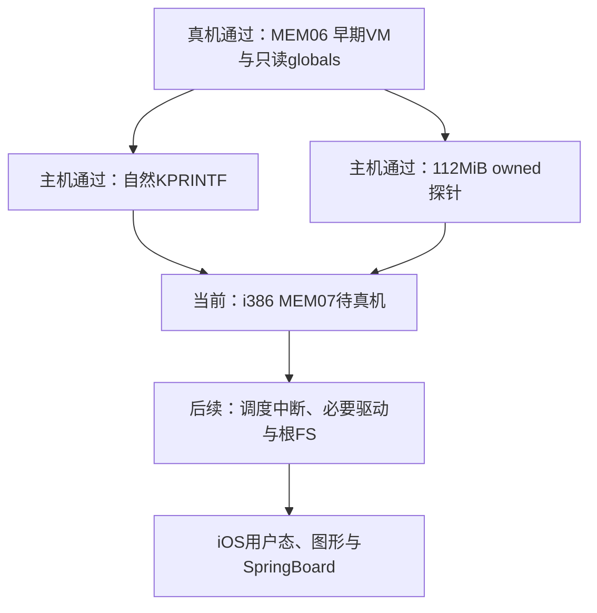

# MEM06 真机结果与 MEM07 i386 联合验证交接

MEM06 已消费：ad9f7536e76def6a20f2e5329abce3a4ae674345cef41ff0f7ac8c9f73d2e8f9，禁止重启。20:12 CST唯一Fastboot接受，20:14两次Android只读7/7。六张本次原图已逐张核验并登记Mac/i386 evidence/hardware-tests/thor-20261026-vm-mem06/visual-review.json；原始L3收据不回改，原图不写Git。

00–0F全部完成：07/0B/0E CALL、08/0C RETURN是原设计的终态，不是停在调用中；0F VM GLOBALS/PASS证明有界真实原生全局只读映射及返回后AT/根/PTE/PTD守卫完成。白字深底获得实拍支持。UEFI3画面是冻结背景，不是之后的XNU程序位置。并未自然进入machine_init或iOS用户态。

五FDT窗口均S22 IN1 DY15 UN2 CF0，低窗口DYW12/高窗口DYW4。快照911204B、CRC06981C37、PAD1/OFF2698，两个未知size节点仍无RAM授权。最后一图下部绿/黄矩形且文字仍可见；静态图不能定位显示缓存、扫描输出或复位原因。M6成功路径无下部绿色Fill。M7新增RESET NEXT标记和严格绘图区/flush交叉检查；不宣称绿块原因已修好。

## 本轮最终状态

新镜像已在i386落地，L2 **529/529 PASS**，Linux控制器READY_NOT_EXECUTED。i386实时USB/Android检查尚待用户接好手机后运行check；历史Mac基线只用于确认同一设备身份，未伪装成本机新观测。助手没有重启/启动手机。

- i386根：/home/vincent/Projects/thor-unixnu
- 镜像：runs/thor-20261026-vm-mem07/l2/package/thor-boot.img，25907200B
- SHA256：fea3b5d12d9908170229f232cfa20bea5769415a2187a0ff9b622f55987da55e
- L2：package/independent-offline.json，SHA dc85fc201887bb8b73301643cd210c882148baf1e92311dbc88dd78f21eac110
- Linux preflight SHA：0e501d79313028d8a8381c1da1615f30d80187cb0dcd470ceff0796c1ca07f0b
- i386最终就绪：l2/i386-final-host-readiness.json；传输证明：evidence/build/vm-mem07/image-transfer/image-transfer-proof.json
- Mac保留raw seed；未复制raw seed文件。boot.img按用户要求复制。Mac有TRANSFERRED_AWAY_DO_NOT_BOOT_HERE，且没有MEM07控制器；唯一启动主机为i386。

## 两条线同一镜像

XNU自然arm_init沿原顺序执行调试状态继承、无串口设备时的serial_init，以及STARTUP_SUB_KPRINTF唯一原生回调。提前的globals诊断调用已移除，slot2保持空，避免自然调用时重复映射。固定800B ADT无arm-io/consistent-debug-root、startup_debug=NONE，真实24B启动表/唯一回调/BL与B目标/CFG支配/无MMIO路径均核对。0F改NAT KPRINTF/PASS，配置12秒有界等待，随后RESET NEXT/1秒再SMC；计数器/迭代安全边界允许提前退出。仍未执行控制台、machine_init、调度中断或驱动。

UEFI真实GetMemoryMap在既有F8000000..FFC00000 heap内找低21位0x4000的112MiB单段Conventional候选，排除8个live区后AllocateAddress、验证新map/GCD WB/AT读写identity、首尾16B可恢复canary，再FreePages和新map复核。无空间显示BLOCK；释放或状态异常STOP。仅完整释放或空间BLOCK可继续既有64MiB XNU验证。probe MapKey不复用为EBS key。

这是完整APFS内核布局前置验证，不是完整加载：实际full kernel SHA a798cf...d3a37、文件50659328B、span113229824B，最小布局113250304B，112MiB之后的完整VM预算仍未证明。当前entry本来就直接消费initrd，不虚报节省FAT/整份Image副本；旧DarwinBoot22完整路径仍需后续改造。生产segment reader新增exact range/length、source live/generation前后复核，未改FDT/ReadPermit授权政策。

新增栈检查挡住两个中间缺陷：错误猜测F600..F800栈范围、20KiB描述符局部数组。最终沿用共享A760D000..A764D000、下界+0x4000，排序工作区改为retained image静态20480B并在ReportZero前拒绝重入。实际native栈帧96/160/208/432B。旧host01/02/03已INVALIDATED，不能打包；只用host05/06最终证据。

## 固定输入与验收

XNU aaf0d8b41197b0bfc2772f078f316e1370478223，actual C 7d360b00c0faf85d64a9fc0215288776913733d6；candidate016九文件，kernel d52a98872ad3fa2ddb24c00c2741e21ff62b69836be7eb996f32afdcbb2eed08，MC f9258c391883905ffe6b7742299bb5cf41b2eababbb3b69986d1157634bd8b8d。两次强制link一致，35新C测试通过，20旧项按固定源/log明确复用。M6三新增基线TU从固定Apple Gitblob和M6两补丁独立重建，不信任可变缓存自证。

UEFI e2333f76e66dabdc8bfff2d1a165956f49d759ad，actual C e1f8866584e2465a10384af596f0afeda24b730c；FD8ba7ff2100fef3a34c2f1732567c024025f9f7528d551d02f9d73cb303034426。host05/06两次真实FD/PE一致；99源测试、22帧、2FV/20PE/96lib/379输入完整审计及Mac重放通过。500B transition因全部几何相同仍de0b5fd081759dde1f579f7741c2a6cab40feea95285e5c9eaee9832a87da195，独立五对地址解码/零word变化/无reloc。

control代码414072e，版本断言修正9edaafe5de7bb70066e7dc290b7a635204aaa665；127打包、88独立gate、24 Linux controller mock回归通过。首次整包验收只因verifier残留MEMDIAG06被拒；已修为07并加3项拒旧版本用例，未改已生成镜像或重采seed。最终260项native precheck02按SHA d6ad8a144d09a21f333caf9cf75545b2e8125787c19a2bfa85f05af7c8e51082复用，完整529项L2在其后封存。历史额外5 CLI注入仍未执行，不计PASS。

## i386 手动命令

连接Android后先运行只读检查，允许连接未就绪时修正后重复check；它不创建execute claim：

```bash
cd /home/vincent/Projects/thor-unixnu && \
/usr/bin/python3 -B runs/thor-20261026-vm-mem07/l2/controller/controller.py check \
  --preflight runs/thor-20261026-vm-mem07/l2/controller/controller-preflight.json
```

check通过后先开始连续录像，再运行一次：

```bash
cd /home/vincent/Projects/thor-unixnu && \
/usr/bin/python3 -B runs/thor-20261026-vm-mem07/l2/controller/controller.py execute \
  --preflight runs/thor-20261026-vm-mem07/l2/controller/controller-preflight.json \
  --recording-confirmed \
  --confirm-run-id thor-20261026-vm-mem07 \
  --confirm-image-sha256 fea3b5d12d9908170229f232cfa20bea5769415a2187a0ff9b622f55987da55e
```

execute失败/中断也不能重跑；旧MEM01–06全部禁用。拍清LDR PLAN、LDR PROBE（PASS/FREE1或BLOCK/STOP及S号）、0F NAT KPRINTF、RESET NEXT与下部绿块出现前后。保留连续录像到返回Android。

```bash
cd /home/vincent/Projects/thor-unixnu && \
/usr/bin/python3 -B runs/thor-20261026-vm-mem07/l2/controller/controller.py monitor \
  --preflight runs/thor-20261026-vm-mem07/l2/controller/controller-preflight.json
```


