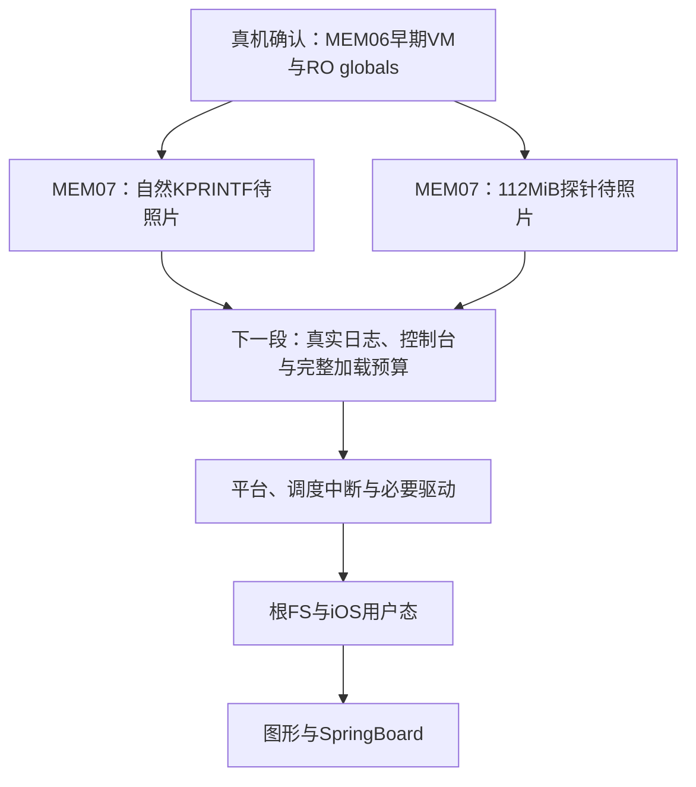

# MEM07 真机执行记录与下一段源码审查

## 已核实的执行结果

用户在i386手动执行，助手没有手机命令。2026-10-26 22:02 CST本机只读检查7/7；22:03:46 Fastboot接受，发送0.638s、启动0.120s、总计0.767s；22:05:50独立Android monitor 7/7。
镜像fea3b5d12d9908170229f232cfa20bea5769415a2187a0ff9b622f55987da55e已消费，自动重试0。i386原始L3不回改。Mac按七份逐SHA核验收据同步消费账本；不得再次启动MEM07。

i386原始记录在runs/thor-20261026-vm-mem07/l3。Mac归档evidence/hardware-tests/thor-20261026-vm-mem07/i386-origin-receipts.json包含七份原始文本及SHA；独立核验脚本archive_mem07_attempt.py。新综合结论l3-assessment-pending-visual.json与旧execution-result分开，旧日志中的PENDING不修改。

## 视觉验收暂未完成

用户提供的五张照片位于Mac微信RWTemp目录：7659eb...、74a6a7...、ee6764...、eada85...、7406cd...。首张元数据显示809387B；多图与单图read_file内容请求均超时，Python实际读内容与sips派生图也阻塞，已停止本轮启动的阻塞读进程。未确定是权限、目录还是服务问题，不声称已看过照片或已找到权限原因。

自然KPRINTF、112MiB分配/释放探针、RESET NEXT与绿块出现次序均PENDING_PHOTO_CONTENT。不能用Fastboot成功或Android恢复替代这些验收。保留最后已确认真机前沿MEM06早期VM/RO globals。需要原图直接进入聊天，或复制到/Users/<user>/projects/thor-unixnu/evidence/hardware-tests/thor-20261026-vm-mem07/incoming/后继续逐张判读，不重做旧L2与构建。

## 已继续完成的下一段源码审查

当前MEM07在arm_init内首个真实kprintf前有界停止；只通过STARTUP_SUB_KPRINTF回调并不意味着执行了kprintf日志路径。pe_kprintf.c的串口输出开启/关闭分支都调用os_log_with_args；log.c随后有msgbuf锁、早期重放、可选分配与firehose路径。下一步须约束启动phase、日志状态、msgbuf与可达分支，再纳入真实机器码门禁。

PE_create_console先检查panic记录，再调用PE_initialize_console/initialize_screen。后者在需映射时以v_length或height*rowbytes调用ml_io_map_unmappable。现诊断FB仅B805A000..B8195000共315页、物理y64..287；整屏1440*3200*4为18432000B/4500页，不能把诊断映射当完整控制台已就绪。PE_init_printf(FALSE)只绑定回调，不能替代上述映射证明。本轮未扩大FB/DRAM授权，未移除stop。

完整APFS内核仍有文件50,659,328B、span113,229,824B和完整VM额外预算问题。MEM07的112MiB probe即便实拍PASS，也只证明临时owned探针，不是完整内核加载；须先读取LDR PLAN/PROBE实际值，再选择下一步分配与源生命周期实现。

上述七份prepared源SHA已记录到l3-assessment-pending-visual.json，工作树和已封存529项L2输入未修改。本轮未生成MEM08、未采新seed，没有新的可启动命令。

## 整体位置

后续只根据实际视觉结果推进；不报无依据完成率或到iOS日期。用户继续录像并手动执行新包；已消费MEM01–07永不重试。
