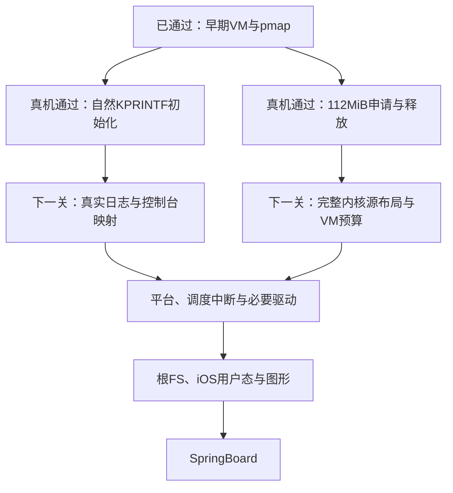

# MEM07 七张实拍验收与下一阶段

MEM07两项主要硬件目标已获实拍支持：自然arm_init执行到STARTUP_SUB_KPRINTF原生回调返回，0F NAT KPRINTF/PASS；UEFI 112MiB临时owned探针LDR PROBE PASS S0 / FREE 1。运行仍为thor-20261026-vm-mem07，镜像fea3b5d12d9908170229f232cfa20bea5769415a2187a0ff9b622f55987da55e已消费，不可重启。

本次七张附件1000013885.jpg至1000013891.jpg已直接读取，原始文件未改动。逐图字节/SHA/观察登记evidence/hardware-tests/thor-20261026-vm-mem07/visual-review.json，SHA c75a93ebeea6aa528c9a58b5643eb89b61b1c9552608ed5539a36cb38c7ab326。先前微信临时路径读取失败不再阻塞主要目标验收；原pending报告保留为历史，本报告覆盖其两个目标待定结论。

## 逐图与检查点

前两张是UEFI 2 KERNEL HASH PASS，initrd只读运输及kernel SHA比对通过，尚未出现XNU顶部网格。后五张保留UEFI 3 BEFORE EBS背景，同时顶部00–0F已经完成；背景文字不是当前执行位置。

00 PREVM、01 TTBR1、02 VBAR ROOT、03 FB ALIAS、04 TTBR0 OFF、05 KVA PTRS、06 REBIND OK、09 METADATA、0A PRE PMAP、0D PMAP GUARD、0F NAT KPRINTF均PASS。07 AUX CALL、0B PMAP CALL、0E L3 CALL为CALL；08 AUX RETURN、0C PMAP RETURN为RETURN。这些是各格保留的预定终态。02部分标题被实体摄像头开孔遮挡，其完成顺序同时由冻结机器码与最终0F守卫关联确认。

0F与冻结candidate016机器码f9258c391883905ffe6b7742299bb5cf41b2eababbb3b69986d1157634bd8b8d的16格逐项匹配，实际kernel d52a98872ad3fa2ddb24c00c2741e21ff62b69836be7eb996f32afdcbb2eed08。原生debug inherit、无SoC串口返回、唯一KPRINTF初始化回调及前后根/PTE/PTD/preemption/avail守卫已走通；尚未执行之后首个自然kprintf、console、machine_init或iOS。

## Loader与五组FDT

LDR PLAN显示112M / ALIGNED116M / MIN108.01M；LDR PROBE PASS S0 / FREE1对应生产代码的AllocateAddress、新LoaderCode map/GCD/AT检查、首尾各8B恢复canary、FreePages与新Conventional map验证。持续owned诊断窗口仍67108864B（64MiB），完整APFS内核尚未加载。

| 窗口 | 基址 | DYW | 共同统计 |
|---|---|---:|---|
| L0 | 0xBAC00000 | 12 | S22 IN1 DY15 UN2 CF0 |
| L1 | 0xCAC00000 | 12 | S22 IN1 DY15 UN2 CF0 |
| H0 | 0x800000000 | 4 | S22 IN1 DY15 UN2 CF0 |
| H1 | 0x810000000 | 4 | S22 IN1 DY15 UN2 CF0 |
| H2 | 0x820000000 | 4 | S22 IN1 DY15 UN2 CF0 |

五窗口各256MiB，仍UNRESOLVED_RESERVATION，无新增RAM授权。快照911204B、CRC8BA76732、COMPLETE1/PAD1/OFF2698。trust_ui_vm_region@e0b00000仍缺reg/size/range且no-map；ramoops_region仍缺reg/size，range为0+FFFFFFFFFFFFFFFF。这两个未知大小节点继续保留。

## 复位和可读性

这七张均未捕获RESET NEXT，也未见先前的大块下部绿背景。只有静态帧，不能定位绿块原因或宣布修好。深底白字清晰；实体摄像头挡住02标题，下一轮调整网格应保持已有315页边界内的绘制契约。

## 下一阶段实际关口

当前initrd为B56D5000..B7FFE80C，共43161612B，距B8000000 framebuffer仅6132B。沿同一起点到FB前仅容43167744B；真实完整APFS kernel文件50659328B（SHA a798cf368ab013e7389f3c5944cea9381859fb98238b346b33423b00bf8d3a37）即使单独放入也超7491584B。以上是当前布局的条件计算，不预测下一包bootloader实际摆放。必须重算源位置或流式读取，不能只换大kernel或放宽阈值。

另一条线推进真实日志与控制台：kprintf关闭串口仍进入os_log，需核早期msgbuf/锁/重放/可选分配；console会按整屏申请映射，现315页诊断映射不能代替4500页整屏证明。完整内核、后续VM预算、平台与调度中断、必要驱动、根FS、iOS用户态与图形仍待。

新视觉报告已在Mac归档并与冻结机器码和区间算术核验。i386短暂离线后恢复，新视觉报告已逐SHA同步；收据evidence/hardware-tests/thor-20261026-vm-mem07/visual-review-i386-sync-proof.json为PASS_IDENTICAL_VISUAL_REVIEW_SHA256。没有新MEM08镜像或seed，助手零手机命令。

