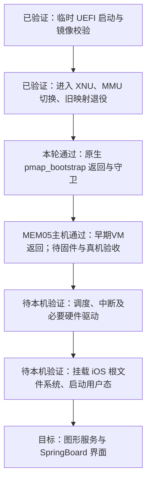

# Thor / UniXNU 当前启动进度（MEM04 L3 后）

本报告以真机实拍和封存收据为依据。每次向用户汇报均展示整体流程图，区分真机通过、主机验证和待验证；不把L2项数或诊断格子换算为完整iOS项目百分比。新镜像/L2就绪后直接发Mac命令，由用户先录像再手动启动；助手不执行手机重启或boot。

MEM04镜像bd37e82c...已由用户于2026-10-26 15:08 CST执行唯一一次临时boot，15:09独立monitor返回PASS_ANDROID_READONLY_7_OF_7。四张实拍的前两张为UEFI2 hash PASS，后两张显示00–0D共14个彩色检查格及0E/0F保留WAIT。按冻结机器码的顺序守卫及精确palette映射推断，原生pmap_bootstrap确已调用、返回并通过元数据/映射守卫；照片小字非全部可独立读出，不伪称逐字OCR或连续视频。图片hash/Library ID和收据绑定见项目evidence/hardware-tests/thor-20261026-vm-mem04/visual-review.json。

五窗口均S22、IN1、DY15、UN2、CF0；低L0/L1的DYW12，高H0/H1/H2的DYW4。两未知保留节点仍缺reg/size，ramoops声明0+FFFFFFFFFFFFFFFF范围，不能授权额外RAM。旧MEM03叠字未在本轮画面复现。MEM04镜像已消费，禁止重复启动。

MEM05在独立XNU/control工作树推进：保留旧低VA分配台账，新增post-pmap独立页数预算、写前RW/单调游标/池容量守卫、两组L3原生循环前后检查、PTD free-list增长排除、实际arm_vm_init返回后的noreturn复核。00–0D保留，0E规划L3 CALL，0F规划VM RETURN。生产C预算/真实PTD守卫12项及CFG8项共20项主机测试通过（含4096种布局、2040种有效PTD槽位组合与负例）。真实内核两次强制链接字节一致，通用对象/内核审计及最终机器码验收通过。新内核765bcb34234def5ba344a593e9ef76176d44d0fdd1576dabef0eae043d1c9c89，候选014，XNU提交16194ea46fcd34b922c9cbe929ea78a76cdf6314。新机器码证明7c26d2fa82704d404781e50616f65ad09878f676521424c7196b48f6971b29fa。此时只有主机内核候选，没有新可启动镜像。

后续至少四组关口：完成早期VM及后续内核初始化；调度/中断与必要硬件驱动；根文件系统及launchd等用户态；显示/图形服务和SpringBoard。现有仓库中某些组件虽有代码或其他环境证据，不能当作本机端到端通过。完整iOS载荷的多副本峰值预算与可用内存所有权仍未解决，尚不能可靠给出需要几轮或几天。
